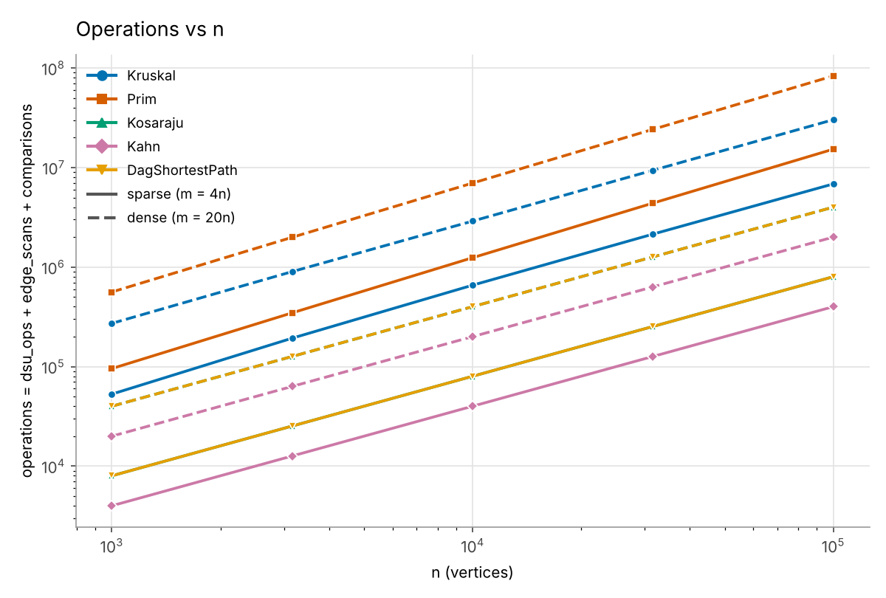
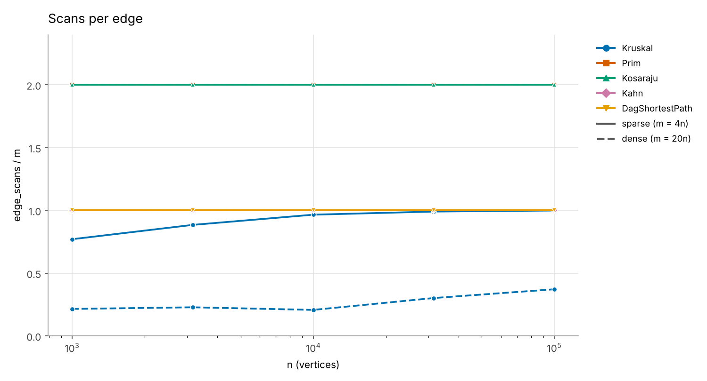
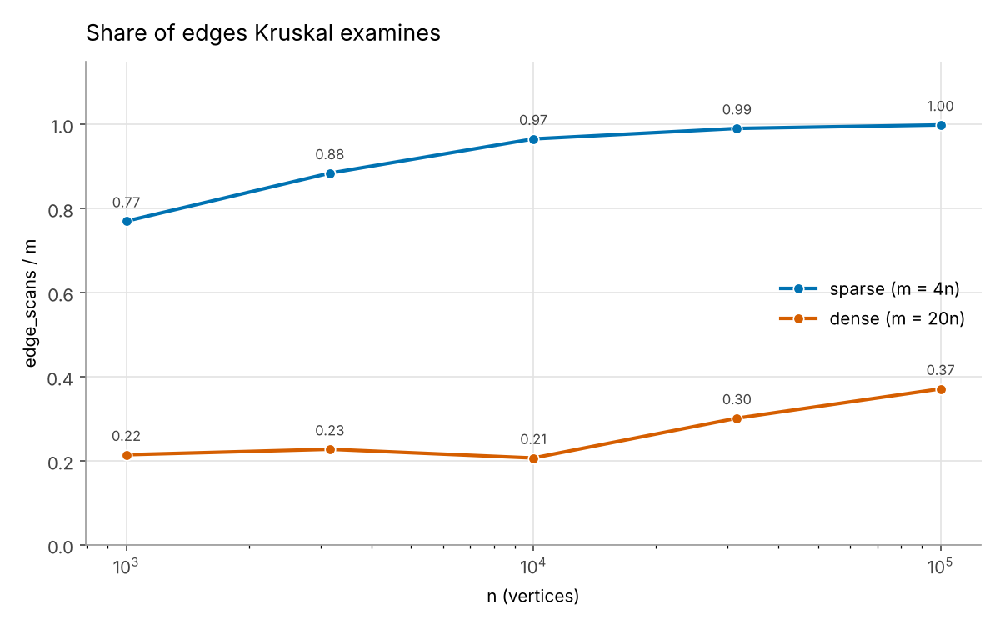

2# Assignment 3 Report: Graphs (DSU, MST, SCC, Shortest Paths)

Everything below comes from one run of the benchmark with `Random(42)`. The counters are the same on every machine, so you can reproduce each number in the tables with `java -jar target/daa-assignment3-1.0.jar` (or the `javac` route in the README). All ten reference values from the assignment (MST weight, SCC count, sum of DAG distances) came out exactly right, and the benchmark stops with an exception if any of them is off.

## 1. Complexity table

V is the number of vertices, E the number of edges. "Extra space" means memory on top of the graph itself.

| Algorithm | Time | Extra space | Why |
|---|---|---|---|
| DSU find / union | O(α(n)) amortized, almost constant | O(n) | Union by rank keeps trees very shallow and path compression flattens them further. α(n) is below 5 for any n we could ever store. |
| Kruskal | O(E log E) | O(E + V) | Sorting the edges costs E log E. After that every edge costs two finds, which is nearly free. I keep a sorted copy of the edge array, plus the DSU. |
| Prim (lazy, PriorityQueue) | O(E log E) = O(E log V) | O(E + V) | Every edge can be pushed into the queue once, and each push or poll costs log of the queue size. Plus a `boolean[]` for the tree. |
| Kosaraju | O(V + E) | O(V + E) | Two DFS passes, each looks at every edge once. The second pass runs on a reversed copy of the graph, which is why the space is V + E and not just V. |
| Kahn | O(V + E) | O(V) | Each vertex enters the queue once, each edge is looked at once when its start vertex leaves the queue. Needs the in-degree array and the queue. |
| DAG shortest paths | O(V + E) | O(V) | One pass over the topological order, every edge is relaxed once. Needs `dist[]` and `parent[]`. |

Small honest note: Kahn computes in-degrees while the graph is built (the graph class keeps an `inDegree[]` array up to date in `addEdge`), so the `edgeScans` counter for Kahn counts only the queue loop and equals exactly m, as the assignment asks.

## 2. Counters against formulas

The idea: if a counter divided by its formula stays about constant while n grows by a factor of 100, the algorithm really behaves like that formula. Sparse is m = 4n and dense is m = 20n. The columns are n = 1 000, 3 162, 10 000, 31 623, 100 000.

| Counter / formula | Density | n=1 000 | 3 162 | 10 000 | 31 623 | 100 000 |
|---|---|---|---|---|---|---|
| Kosaraju edgeScans / (V+E) | sparse | 1.600 | 1.600 | 1.600 | 1.600 | 1.600 |
| | dense | 1.905 | 1.905 | 1.905 | 1.905 | 1.905 |
| Kahn edgeScans / (V+E) | sparse | 0.800 | 0.800 | 0.800 | 0.800 | 0.800 |
| | dense | 0.952 | 0.952 | 0.952 | 0.952 | 0.952 |
| DAG paths edgeScans / (V+E) | sparse | 0.800 | 0.800 | 0.800 | 0.800 | 0.800 |
| | dense | 0.952 | 0.952 | 0.952 | 0.952 | 0.952 |
| Prim edgeScans / 2E | both | 1.000 | 1.000 | 1.000 | 1.000 | 1.000 |
| Prim comparisons / (E log2 E) | sparse | 0.844 | 0.869 | 0.891 | 0.911 | 0.923 |
| | dense | 0.853 | 0.870 | 0.884 | 0.894 | 0.903 |
| Kruskal comparisons / (E log2 E) | sparse | 0.891 | 0.907 | 0.869 | 0.809 | 0.745 |
| | dense | 0.903 | 0.846 | 0.784 | 0.720 | 0.666 |
| Kruskal dsuOps / edgeScans | sparse | 2.324 | 2.283 | 2.259 | 2.252 | 2.250 |
| | dense | 2.232 | 2.219 | 2.241 | 2.166 | 2.135 |

What I read from this:

- **Kosaraju, Kahn and the DAG pass** are perfectly flat. The values are not 1.0 because (V+E) also contains V, but they are the same at every size, which is exactly what O(V + E) means. Kosaraju is exactly 2m scans and Kahn and the DAG pass are exactly m scans, at every size.
- **Prim** scans every adjacency entry once (2E in total) and its queue work stays close to E log E. The ratio creeps up from 0.84 to 0.92 but it is bounded by 1, so it fits the formula.
- **Kruskal** has two things worth explaining. First, `dsuOps / edgeScans` is flat at about 2.2: every edge it looks at costs two `find` calls, plus at most V−1 successful unions. Second, I wrote `dsuOps / E` in the assignment's example form, but I do not use that one as proof because it is not flat for Kruskal: 0.48 to 0.79 on dense graphs and 1.79 to 2.25 on sparse ones. The reason is that Kruskal stops as soon as the tree has V−1 edges, so it does not look at all E edges (see section 6). Dividing by the edges it really looked at gives the flat line.
- **Kruskal comparisons** fall below E log2 E more and more as the graph grows (0.90 down to 0.67). It is still below the bound, so O(E log E) holds. I think the reason is that all weights are between 1 and 1000, so a big graph has thousands of equal weights, and Java's sort (TimSort) skips through blocks of equal keys with fewer comparisons than the textbook count. I did not prove this, it is my explanation.

## 3. Slope check

On log-log axes, a line with slope 1 means the work grows in step with the input. I fitted a straight line through the five points of each curve (edgeScans against m).

| Algorithm | Slope, sparse | Slope, dense |
|---|---|---|
| Prim | 1.000 | 1.000 |
| Kosaraju | 1.000 | 1.000 |
| Kahn | 1.000 | 1.000 |
| DAG shortest paths | 1.000 | 1.000 |
| Kruskal | 1.055 | 1.119 |

So the traversals are exactly linear and Kruskal is a bit steeper, as expected. Kruskal's curve is not steeper because of its sort (the sort shows up in `comparisons`, where Kruskal's slope is 1.055 on sparse and 1.016 on dense graphs). It is steeper in `edgeScans` because the number of edges it needs before the graph becomes connected grows a little faster than n (I believe roughly like n log n for random weights, but I only measured it, I did not prove it).

## 4. Correctness arguments

**Cut property, and how Kruskal and Prim use it.** Take any way of splitting the vertices into two groups (a cut). The cheapest edge that crosses between the groups belongs to some minimum spanning tree. Here is why: take an MST that does not contain this edge e. Adding e to that tree creates a cycle, and the cycle has to cross the cut at least one more time, through another edge f. Since e is the cheapest crossing edge, w(e) ≤ w(f). Swap f for e and you still have a spanning tree, and it is not heavier, so it is also an MST. Kruskal uses this by taking the globally lightest edge that joins two different components: the cut is "this component against everything else", and the edge is the lightest one crossing it, so it is safe. Prim uses it more directly: the cut is "vertices already in the tree against the rest", and the priority queue always hands over the lightest crossing edge. Both build a tree out of safe edges only, so both end with an MST, which is why they always agree on the total weight (and the benchmark checks that for all ten graphs).

**Induction on the topological order, and why one pass is enough in a DAG.** Let v1, v2, ..., vn be the topological order. Claim: when we start to relax the outgoing edges of vi, dist[vi] is already the true shortest distance. For the first vertex there is nothing before it, so it must be a source (in-degree 0), and its distance 0 is right. Now assume the claim is true for all vertices before vi. Every edge that enters vi comes from a vertex that is earlier in the order. All of those were already processed, their distances are final by the induction assumption, and each of them relaxed its edge into vi. The shortest path to vi ends with one of those edges, so dist[vi] is the minimum over exactly the candidates we tried. Therefore it is correct, and nobody will ever change it later because later vertices cannot have an edge back to vi. Doing this for all i finishes the proof: one pass, each edge used once, O(V + E).

**Why negative weights are safe in a DAG but not in a general graph.** The proof above never said "weights are non-negative". It only used the order. Dijkstra is different: it freezes the closest vertex first and assumes that a longer way can never become shorter, and a negative edge breaks that. In a general graph with negative weights there is an even bigger problem: a cycle with negative total weight can be walked again and again, so the "shortest" distance goes to minus infinity and does not exist. A DAG has no cycles at all, so each path is simple and short, and negative weights only change which path wins. My tests check this against Bellman-Ford on 200 random DAGs with weights from −15 to 25.

## 5. Which algorithm when

| Situation | I would use | Why |
|---|---|---|
| MST, edges given as a list, sparse graph | Kruskal | The sort is cheap when E is small, and the DSU needs no adjacency structure. In my sparse runs it scanned almost all edges but still needed fewer comparisons than my Prim (5.5 million against 14.5 million at n = 100 000). |
| MST, graph stored as adjacency list, dense graph | Prim (ideally with an indexed heap) | Prim never sorts all edges. With a decrease-key heap it is O(E + V log V). My lazy version with a plain `PriorityQueue` is not that fast, see the note below. For a really dense graph stored as a matrix, the simple O(V²) Prim is the best. |
| MST, edges arrive one by one, or I also need "are these two connected?" | Kruskal / DSU | DSU answers connectivity in almost constant time and edges can come in any order. |
| Graph may be disconnected | Either | Both return a forest. Kruskal gets the component count from the DSU, Prim restarts from every unvisited vertex. |
| Dependencies between jobs, may contain a cycle | Kahn | If fewer than n vertices leave the queue, there is a cycle and Kahn says so instead of returning a wrong order. |
| Find groups of jobs that wait on each other (deadlocks) | Kosaraju | Each strongly connected component with more than one job is a deadlock group. Linear time. |
| Shortest paths, graph known to be a DAG, negative weights possible | DAG relaxation in topological order | O(V + E), one pass, negative weights are fine. |
| Shortest paths, cycles possible, weights non-negative | Dijkstra (not part of this assignment) | Needs non-negative weights. |
| Shortest paths, cycles possible, negative weights | Bellman-Ford (not part of this assignment) | Slower, O(VE), but it can detect negative cycles. |

A note about Prim and dense graphs, because my numbers do not follow the textbook story. In my benchmark Kruskal did less work than Prim on dense graphs (for n = 100 000: 27.9 million comparisons against 79.2 million). Two reasons: my Prim is the lazy version, which pushes up to one queue entry per edge, and Kruskal stops after looking at only 21% to 37% of the edges on dense graphs. So for random weights and a PriorityQueue-based Prim, the counters say Kruskal. The usual argument for Prim on dense graphs is about the better heap, which I did not implement.

## 6. Plots

**Operations vs n.** One line per algorithm and density (operations = dsu_ops + edge_scans + comparisons). All lines are close to straight with slope near 1. Kosaraju and the DAG pass sit on top of each other (2m operations each), so the green line is hidden under the orange one.

**Scans per edge.** Flat lines mean linear work. Kosaraju and Prim are at 2, Kahn and the DAG pass at 1 (same hiding effect). Only Kruskal moves, because it stops early.

**Share of edges Kruskal examines.** This plot explains where each MST algorithm wins. On sparse graphs (m = 4n) Kruskal has to look at almost every edge (77% at n = 1 000, 99.9% at n = 100 000), because a sparse random graph is barely connected and the last edges it needs are the heavy ones. On dense graphs (m = 20n) it only looks at about 21% to 37% of the edges. The share goes up slowly with n, which is the log factor from the slope check.

## 7. A word about time

I put the median of five runs into `time_ms` in the CSV. For the biggest dense graph (n = 100 000, m = 2 000 000) the numbers were: Kruskal 588 ms, Prim 2 144 ms, Kosaraju 664 ms, Kahn 37 ms, DAG paths 35 ms. The order matches the counters, but I do not use the clock as evidence. These times depend on my machine, the JVM version, the JIT warm-up (the first small graphs run partly in cold code, so on n = 1 000 the times are mostly noise) and whatever else was running at the time. On another laptop the numbers could change, while `edge_scans`, `comparisons` and `dsu_ops` stay identical because they are counted inside the algorithms and the generator is seeded.

## 8. Extra: stack safety

Both DFS passes of Kosaraju use their own `int[]` stack, so the JVM stack is never touched. The deepest the explicit stack got is saved in `max_depth`: for example 59 668 for n = 100 000 sparse and 91 920 for n = 100 000 dense. There is also a test that runs Kosaraju on a path of 100 000 vertices inside a thread with a 128 KB JVM stack, which would overflow with a recursive DFS after a few thousand levels.
